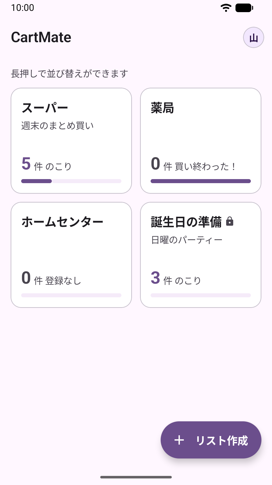
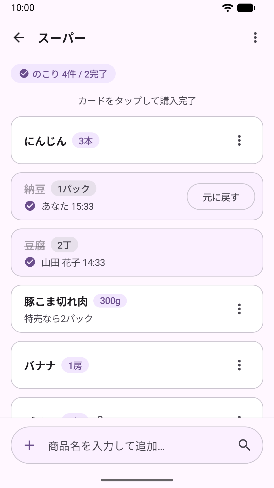
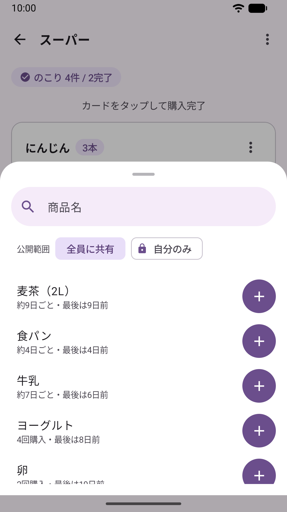
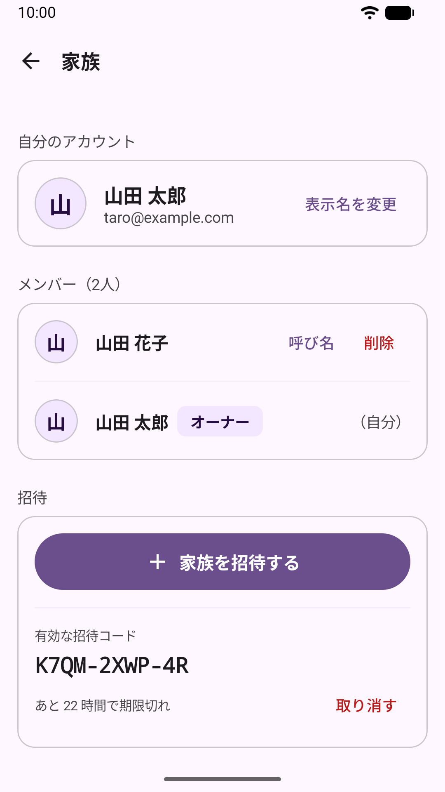

# CartMate

家族で共有する買い物リストの Android アプリです。「スーパー」「薬局」など買い物先ごとにリストを分けて、家族全員でリアルタイムに確認できます。購入履歴から「そろそろ買う時期」の商品を提案します。

> **開発状況**: MVP のフェーズ1〜5（[ロードマップ](docs/roadmap.md)）を実装済みで、Google Play の内部テストで配布しています。AI による名寄せの候補（フェーズ6）と受け入れテスト（フェーズ7）はこれからです。

<p>
  
  
  
  
</p>

ほかの画面は [docs/screenshots/](docs/screenshots/) にあります。

## 主な機能

- **買い物先ごとのリスト**: 好きな名前でリストを作り、2列のカードで残りの件数と進み具合を表示。長押しで並び替え
- **家族で共有**: Google でログインし、招待リンク（App Links）か10文字の招待コードで家族に参加。追加・チェックは家族の端末にすぐ反映
- **買い物中の操作**: Enter で即追加と連続入力、数量・単位・メモ、タップでチェックと「元に戻す」、スワイプ操作。チェックした人と時刻を表示し、チェックを外せるのはチェックした本人だけ
- **オフライン**: 店内で電波がなくても追加・チェックができ、接続が戻ると共有される
- **公開範囲**: リストと項目を「自分のみ」にできる（Security Rules で家族から隠す）
- **予測とサジェスト**: 同じ商品を3回買うと購入周期を推定し、時期が近い商品を候補に出す。よく買う商品、前回の数量と単位、いつもより早い再購入の注意
- **商品の名寄せ**: 同梱の辞書による表記ゆれの吸収、商品をまとめる画面、商品ごとの購入履歴、予測から外す・非表示にする
- **家族とアカウント**: 表示名と呼び名、招待の取り消し、メンバーの削除、離脱とオーナーの引き継ぎ、ほかの家族への合流、アプリ内でのアカウントの削除

振る舞いの詳細は [要件](docs/requirements.md) にあります。

### 現在の制限

- プッシュ通知はありません。家族がチェックしたときのお知らせは、そのリストを開いている間だけ Snackbar で出します。
- 要件にある「未同期」マーク（§3.3）は未実装です。オフラインのバナーはリスト一覧にだけ表示します。
- 日本語のみ、明るい配色のみ（ダークテーマなし）、スマートフォン向けの画面のみです。
- 使うには Google アカウントでのログインと、家族の作成か参加が必要です（1人の家族でも使えます）。

## 技術スタック

- Kotlin / Jetpack Compose（Material 3）/ Hilt / Navigation Compose
- Firebase Authentication（Credential Manager による Google ログイン）
- Cloud Firestore（Snapshot Listener によるリアルタイム同期、オフラインのキャッシュ）
- Firebase App Check（リリース版は Play Integrity。Firestore で強制）
- Firebase Hosting（招待リンクのフォールバック、`assetlinks.json`、プライバシーポリシー、アカウント削除の案内）
- 自前のサーバーや Cloud Functions は持ちません

## 開発

### 必要なもの

- JDK 17 以上（CI は 21）
- Android SDK（compileSdk 37、minSdk 26）
- Node.js 20 と npm（Security Rules のテスト、Firebase のエミュレータ）
- Python 3（テストデータの投入）

### セットアップ

1. **`app/google-services.json` を置く**（リポジトリには含めません）。Firebase コンソールか `firebase apps:sdkconfig ANDROID <App ID> --out app/google-services.json` で取得します。ビルドに必要です。
2. **デバッグ用の鍵の SHA-1 と SHA-256 を Firebase に登録する**。Google ログインに必要です。
3. **デバッグ版の App Check のトークンを登録する**。本番の Firestore は App Check を強制しているため、デバッグ版は起動時に Logcat に出るトークン（`adb logcat -d | grep 'App Check debug token'`）を Firebase コンソールに登録しないと読み書きできません。本番につなぐのは実機だけにし、Android Emulator は Firebase のエミュレータにつなぎます。

詳しくは [architecture.md](docs/design/architecture.md#firebase-の設定) と [release.md](docs/release.md#app-check-の強制) を見てください。Android Studio で開く場合は、リポジトリのルートを開きます。

### ビルドとテスト

```sh
./gradlew assembleDebug                   # デバッグ APK をビルド
./gradlew :domain:test                    # domain の単体テスト（予測・サジェスト・入力の状態遷移・辞書の検証など）
./gradlew :app:testDebugUnitTest          # app の単体テスト（ViewModel など）
./gradlew :app:lintDebug                  # lint
./gradlew :app:connectedDebugAndroidTest  # Compose UI テスト（エミュレータか実機が必要）

cd firebase/rules-test && npm ci && npm test   # Security Rules のテスト（Firestore のエミュレータで実行）
```

CI（GitHub Actions）では、単体テスト・lint・Security Rules のテストを実行します。Compose UI テストは CI では実行しないので、手元で実行してください。Firebase のエミュレータを使う結合テスト、キーボードのタイミングに依存するテスト、名寄せ辞書の計測は [testing.md](docs/testing.md) にあります。

### テストデータとスクリーンショット

```sh
python3 tools/testdata/seed.py   # Firebase のエミュレータにテストデータを入れる（前に入れたデータは消える）
tools/screenshots/take.sh        # Android Emulator で全画面を撮り、docs/screenshots を置き換える
```

エミュレータの起動とつなぎ方（`-PfirebaseEmulator`）は [testing.md](docs/testing.md#テストデータ) にあります。

### リリース

リリース版は、リポジトリの外に置いたアップロード鍵で署名します。ルートの `keystore.properties`（コミットしない）があれば署名し、なければ未署名のままビルドします。

```sh
./gradlew :app:bundleRelease   # app/build/outputs/bundle/release/app-release.aab
```

鍵の作り方、Play Console への登録、データセーフティ、App Check の強制は [release.md](docs/release.md) にあります。

## リポジトリ構成

```
app/          Android アプリ（UI、ViewModel、Firestore と Auth の実装、DI）
domain/       Android に依存しない Kotlin のロジック（予測・サジェスト・正規化・入力の状態遷移・家族の判定）
dictionary/   名寄せ辞書の元データ（CSV。ビルド時にアプリのアセットへ写す）
firebase/     Security Rules、インデックス、Hosting のページ、rules-test
tools/        テストデータの投入、スクリーンショットの撮影、名寄せ辞書の作成の補助
docs/         要件、設計、ロードマップ、リリース手順、ストアの掲載文、スクリーンショット
```

## ドキュメント

- [MVP 要件](docs/requirements.md) — アプリがどう振る舞うか
- [設計資料](docs/README.md) — データモデル、セキュリティ、同期、画面、サジェストの設計
- [ロードマップ](docs/roadmap.md) — 実装フェーズ
- [テスト戦略](docs/testing.md)
- [リリースの手順](docs/release.md) — Play Console、署名、データセーフティ、App Check
- [Google Play の掲載文](docs/google-play-listing.md)
